# TRMNL 心脏电生理知识卡片 · Cardiac EP Knowledge Cards

面向**刚进入心脏电生理（EP）领域的医学生**的墨水屏学习卡片插件。现已完成**基础组全量 24 张卡片（8 大电生理主题 × 3 张）**，每张卡片聚焦一个临床或腔内电图顿悟点，以**语义化极简矢量简笔画 / 参数化电生理波形图 + 严格字数控制的中英排版**构建，并基于 **TRMNL Framework v3.4.6 官方布局类**适配从 `7.5"` 黑白屏到 `10.3"` TRMNL X 与四色墨水屏的多代硬件。

---

## 全量 24 张基础组总览（800×480 实拍级渲染）

| 分组 | 涵盖主题（每组 6 张） | 预览总览 |
| :--- | :--- | :---: |
| **传导解剖 · 基础间期** | #1 Koch 三角、#2 希浦分支、#3 CS 与二尖瓣环、#4 AH/HV、#5 His 定位阻滞、#6 CS 激动顺序 | 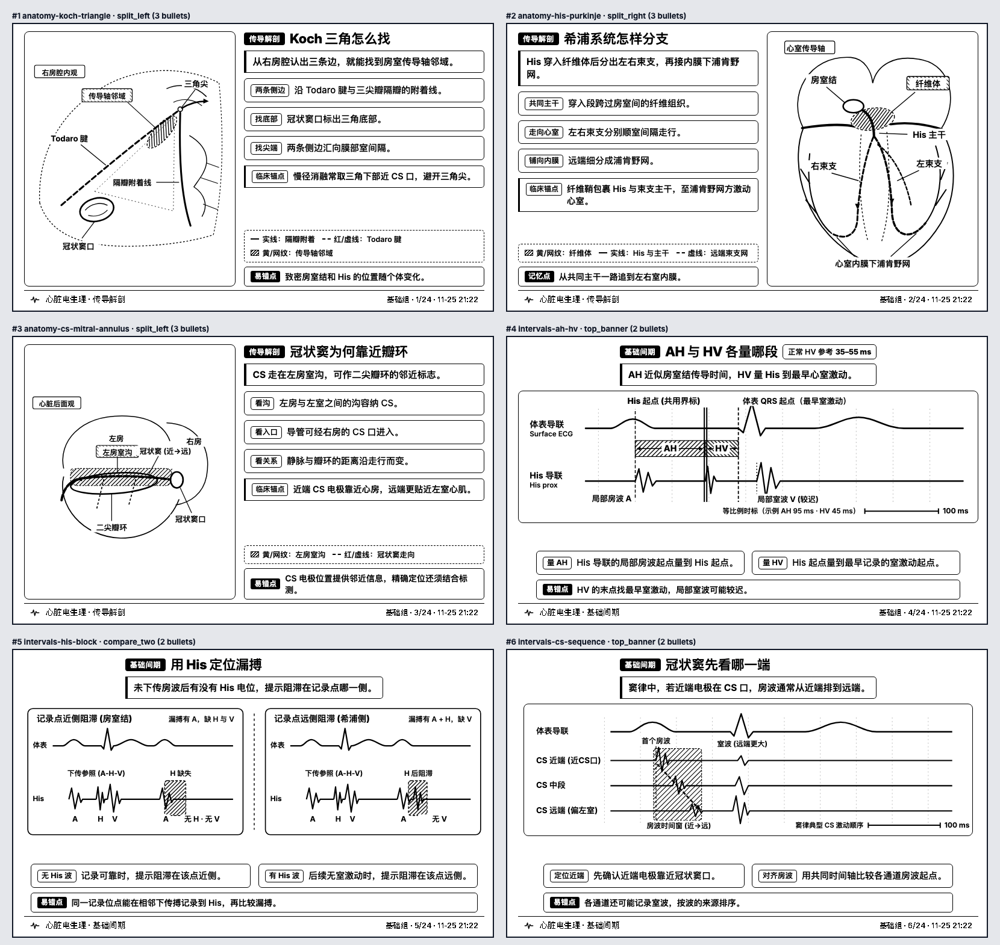 |
| **折返机制 · 室上速鉴别** | #7 折返三要素、#8 AH 跳跃、#9 兴奋间隙、#10 典型 AVNRT 短 VA、#11 RP/PR 分流、#12 假性 r'/s | 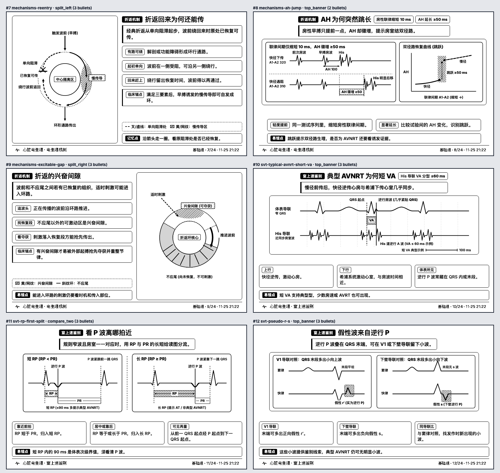 |
| **预激旁路 · 起搏手法** | #13 delta 波、#14 顺逆向 AVRT、#15 显性/隐匿旁路、#16 His 不应期 PVC、#17 V-A-V/V-A-A-V、#18 旁 His 起搏 | 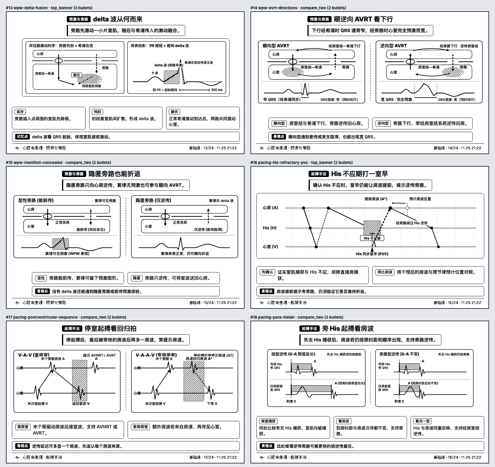 |
| **宽波鉴别 · 消融安全** | #19 胸导 R-S >100 ms、#20 房室分离、#21 夺获与融合搏、#22 慢径交界搏、#23 避让传导轴、#24 不可诱发复测 | 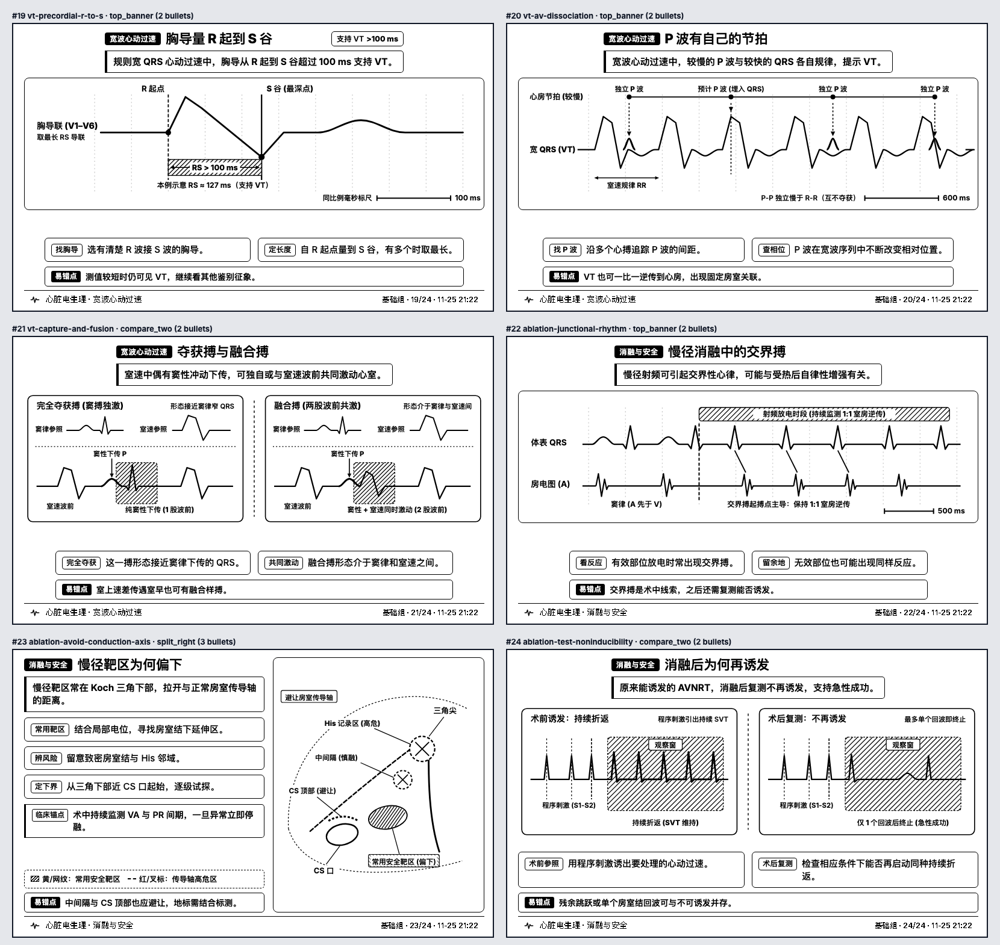 |

## 多墨水屏实拍渲染预览（同源 JSON + 同源语义 SVG）

| 样板卡片 | 7.5" 黑白 1-bit (`800×480`) | 四色墨水屏 BWRY (`800×480`) | 10.3" TRMNL X 4-bit (`1040×780`) |
| :--- | :---: | :---: | :---: |
| **Koch 三角怎么找**<br>`anatomy-koch-triangle` (`split_left`) | 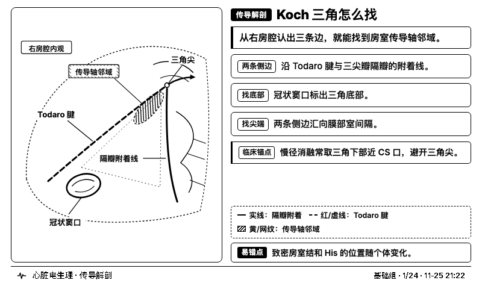 | 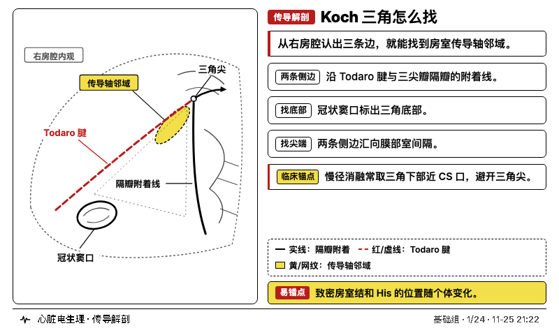 | 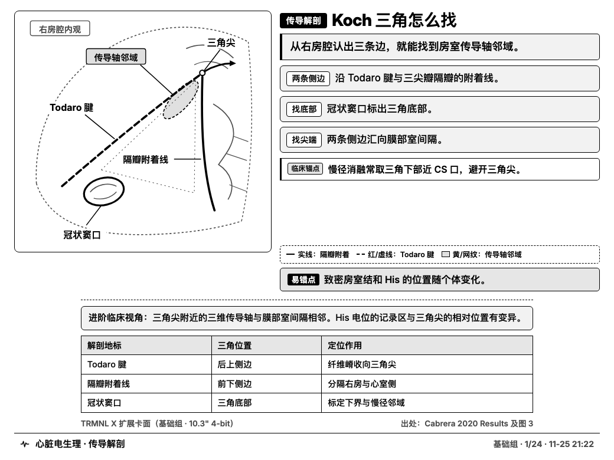 |
| **AH 与 HV 各量哪段**<br>`intervals-ah-hv` (`top_banner`) | 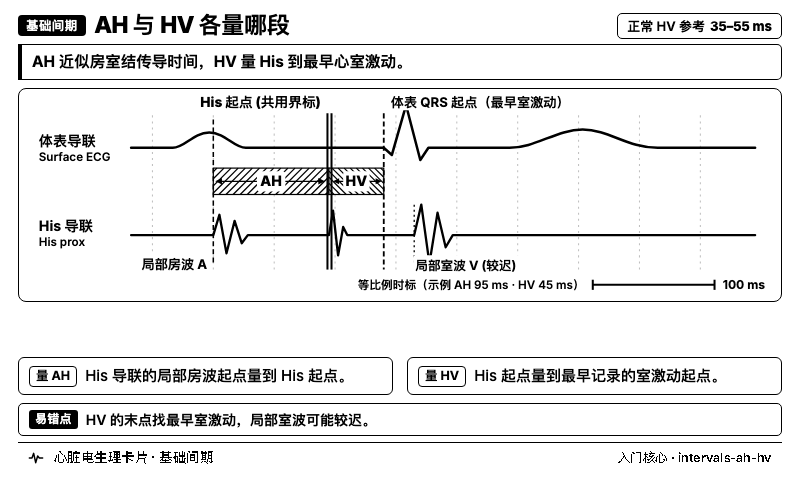 | 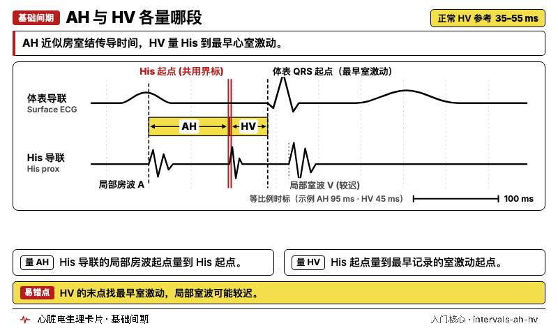 | 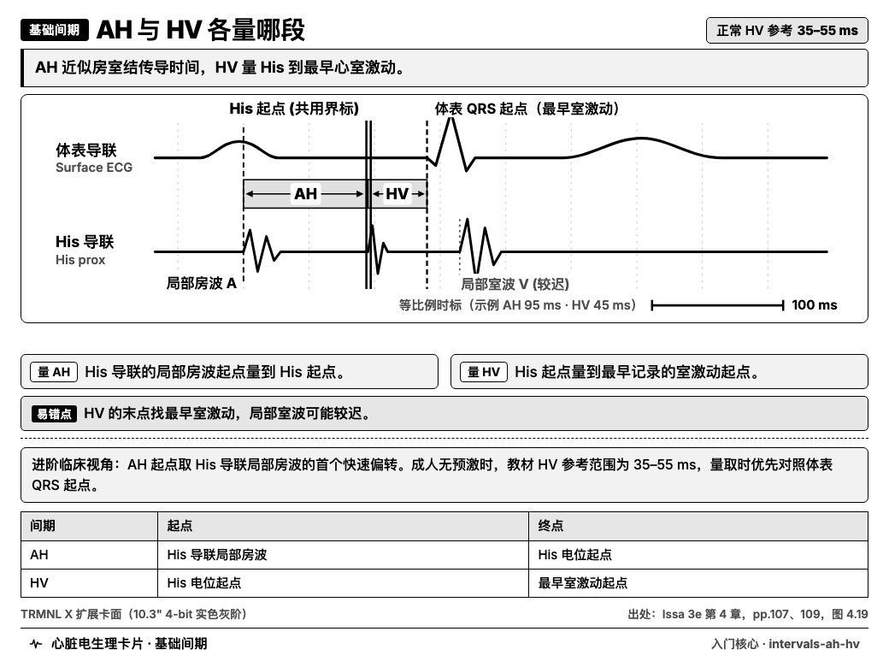 |
| **顺逆向 AVRT 看下行**<br>`wpw-avrt-directions` (`compare_two`) | 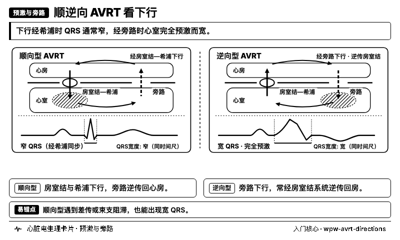 | 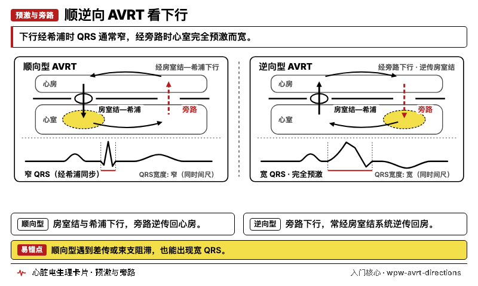 | 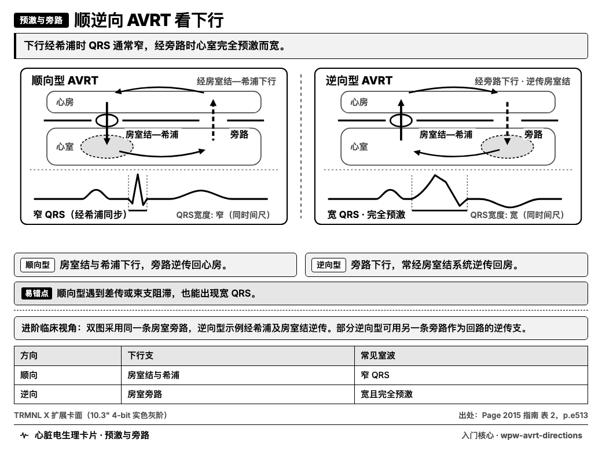 |

---

## 核心工程特性

- **TRMNL Framework v3.4.6 官方响应式布局**：模板直接使用 `view--full`、`layout--col`、`flex`、`flex--row`、`portrait:flex--col`、`grid--cols-2/3`、`hidden lg:flex`、`w--full`、`h--full`、`title_bar` 等官方工具类，确保未来新尺寸墨水屏与横竖屏切换最小化改动。
- **双分级卡组体系（基础组 / 进阶组）**：Schema 原生支持 `tier`（`"basic"` / `"advanced"`）与分栏 `split_note` 临床锚点，收紧所有左右分栏卡的底部留白，并以 [`prompts/gpt-ep-cards-advanced-prompt.md`](prompts/gpt-ep-cards-advanced-prompt.md) 为后续 24 张进阶卡组预留统一生成规范。
- **一图通吃黑白与多色墨水屏**：不使用彩色位图抖动（避免灰蒙蒙与噪点吃字）。所有解剖线稿与电生理标尺均为**纯矢量语义 SVG**：
  - 在 `screen--color-4bwry` / `screen--color-6a` 上高亮纯正红/黄墨水；
  - 在 `screen--1bit` / `screen--2bit` 上自动切换为**粗虚线 + 双线游标 + 45° 斜线网纹**；
  - 在 `screen--4bit`（10.3" TRMNL X）上切换为实色浅灰底带，并利用 `hidden lg:flex` 自动解锁进阶临床视角与对照小表。
- **Terminus Sanitizer 原生兼容**：所有 SVG 与 CSS 不含 `<defs>` / `<pattern>` / `<marker>` / 自定义 `--*` CSS 变量，已通过 [check_terminus_sanitize.py](tools/check_terminus_sanitize.py) 静态检查（模板 + 24 张内嵌 SVG 零错误）；Terminus 使用 `mode: "text"` 禁用抖动，保持汉字笔画锐利。
- **严谨医学校验**：每张卡片绑定 `card.schema.json`、缩写白名单（23 个常用缩写）、800×480 字数硬上限与文献出处（[validate_cards.py](tools/validate_cards.py)）。

---

## 快速安装与使用

### 方式一：自托管 Terminus (BYOS) + 本地数据源

1. **导入扩展包**：下载或使用本仓库生成的 [`dist/ep-cards-terminus-extension.zip`](dist/ep-cards-terminus-extension.zip)，在 Terminus Web UI (`Extensions → Import`) 导入（`mode: "text"`）。
2. **连接数据源**：默认轮询 `http://192.168.10.135:8080/EPCards/card.json`（由 `haos/ep_cards.py` 托管在 HAOS `local_trmnl_serve`）。
   - 若想在调试时固定查看某一张卡，可将 Exchange URL 改为 `/EPCards/anatomy-koch-triangle.json`、`/EPCards/intervals-ah-hv.json` 或 `/EPCards/wpw-avrt-directions.json`。
   - 访问 `GET http://<HAOS_IP>:8080/EPCards/rotate` 可立即切换到下一张卡片。
3. **手动渲染与绑定设备**：在 Terminus 中点击 `Build` 立即渲染 800×480 PNG，并将该 Extension 加入目标设备（如实验机）的 Playlist。

### 方式二：官方 TRMNL Cloud Recipe（零自建服务器）

1. 本仓库通过 GitHub Actions + GitHub Pages 每 2 小时自动构建并轮换静态 JSON 接口：
   - 当前激活卡片：`https://wenkaijie27-rgb.github.io/trmnl-ep-cards/current.json`
   - 完整卡组索引：`https://wenkaijie27-rgb.github.io/trmnl-ep-cards/cards.json`
   - 基础组专属接口：`https://wenkaijie27-rgb.github.io/trmnl-ep-cards/basic/current.json` 与 `/basic/cards.json`
   - 单卡直连：`https://wenkaijie27-rgb.github.io/trmnl-ep-cards/cards/<id>.json`
2. [`trmnl-recipe/src/`](trmnl-recipe/src/) 包含完整的 `settings.yml`（含 `tier` 分组字段）、`shared.liquid`、`full.liquid`、`half_horizontal.liquid`、`half_vertical.liquid` 与 `quadrant.liquid`，可直接用于 `trmnlp` 本地预览或创建 Private Plugin / Recipe。

---

## 目录结构

```text
├── .github/workflows/ci-and-pages.yml  # 校验 + 构建 + GitHub Pages 自动部署
├── decks/
│   ├── basic-24.json                   # 基础组全量 24 张卡片（8 主题×3 卡，tier="basic"）
│   ├── golden-3.json                   # 首批 3 张黄金样板卡
│   └── batch-01-draft.json             # 首批 24 张内容初稿
├── docs/
│   ├── SCHEMA_SPEC.md                  # 数据契约、字数预算与多屏配色规范
│   └── previews/                       # 24 张总览表与多屏验收截图
├── prompts/
│   └── gpt-ep-cards-advanced-prompt.md # 进阶组 24 张卡片 GPT 文献筛选 Prompt
├── haos/ep_cards.py                    # HAOS local_trmnl_serve 数据轮换脚本
├── prototype/                          # 本地 Chrome 多屏截图预览器与 24 卡批渲染脚本
├── schema/card.schema.json             # JSON Schema (Draft 2020-12)
├── shared/ep_cards.css                 # Terminus Sanitizer 安全多屏样式表
├── terminus/                           # Terminus configuration.yml & template.html.liquid
├── trmnl-recipe/src/                   # TRMNL Cloud Recipe (full/half/quadrant)
├── tools/
│   ├── validate_cards.py               # Schema、字数、缩写与版式校验器
│   ├── svgs/                           # 24 张卡的模块化 Sanitizer 安全语义 SVG 构建器
│   ├── generate_svgs.py                # 导出 24 张 SVG 预览资源
│   ├── build_dist.py                   # 构建 dist/ JSON、ZIP 与 Recipe
│   └── check_terminus_sanitize.py      # Terminus sanitize.yml 合规审计
└── dist/                               # 构建输出 (current.json, cards.json, basic/, cards/, ZIP)
```

---

## 本地校验与重建命令

```bash
python3 tools/validate_cards.py decks/golden-3.json
python3 tools/validate_cards.py decks/basic-24.json
python3 tools/generate_svgs.py
python3 tools/build_dist.py
python3 tools/check_terminus_sanitize.py
```

## License

MIT License — 仅用于医学教育与墨水屏显示研究，不作为临床诊疗直接依据。
